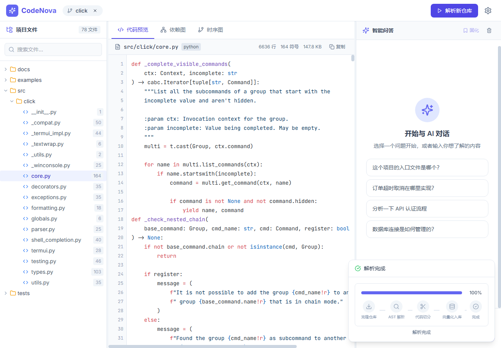
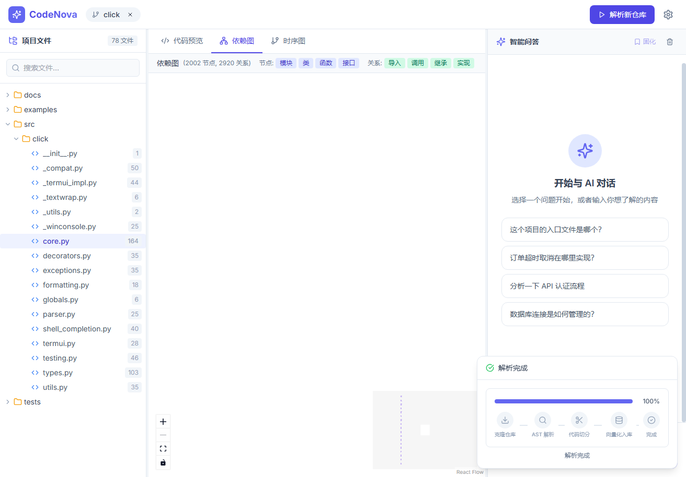
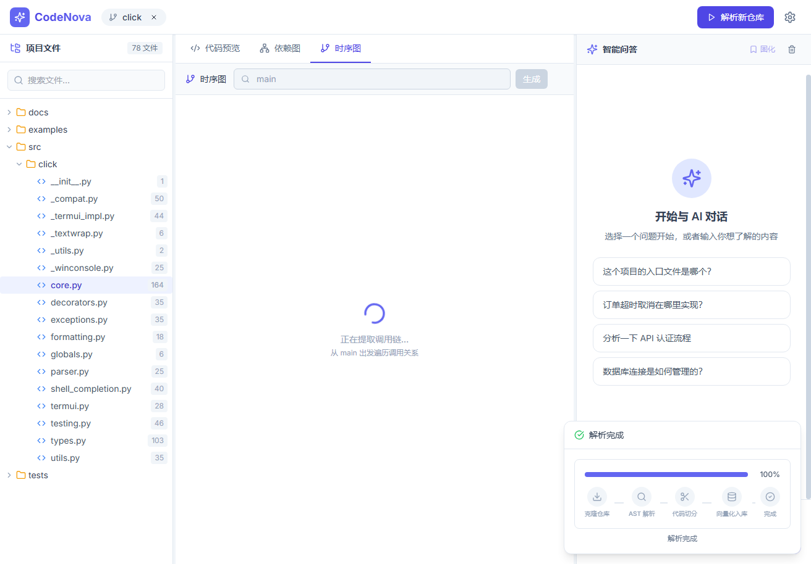
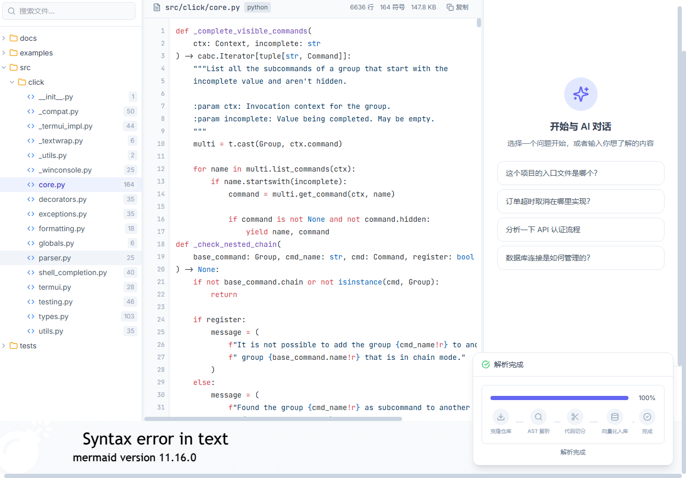

# CodeNova 智码星

[English](docs/README.en.md) | **简体中文**


[](https://codecov.io/gh/zhangwudef/codenova)

> 让每一行代码自己开口说话 —— 基于 AST + 双索引 RAG 的代码理解与文档自动化平台

输入一个代码仓库，输出可问答、可导航、可视化的技术知识库。面向接手老项目的开发者、开源项目维护者、技术团队新人，降低代码理解与文档维护成本。

---

## ✨ 效果展示

> 截图取自本地 Demo（被解析仓库 [pallets/click](https://github.com/pallets/click)），完整功能可通过 `docker-compose.demo.yml` 一键复现。

### 主界面（三栏 IDE 风格布局）


### 依赖关系图（ReactFlow）


### 调用时序图（Mermaid）


### 智能问答（带源码定位）


### 🎬 在线 Demo

> 🚧 在线 Demo 部署中。一键自部署见 [docs/DEPLOYMENT.md](docs/DEPLOYMENT.md)（支持 Render / Fly.io / Railway，零成本 5 分钟上线）。
>
> 同时可使用本地 Demo：`docker compose -f docker-compose.demo.yml up -d`，访问 http://localhost:5173

---

## 🎯 解决什么问题

1. **文档与代码脱节** —— 代码迭代快，文档更新慢，最终失效
2. **理解成本高** —— 大型代码库阅读门槛高，缺乏交互式探索手段
3. **知识不可复用** —— 团队经验沉淀在个人脑中，无法成为可检索资产

## 🆚 与同类产品的区别

| 维度 | Bloop / Greptile / Sourcegraph Cody | Mintlify / Swimm | **CodeNova** |
| --- | --- | --- | --- |
| 形态 | 闭源 SaaS | 闭源 SaaS | **开源、可自托管** |
| 数据隐私 | 代码上云 | 代码上云 | **全本地处理** |
| 切分策略 | 未公开 | 未公开 | **AST 级语义切分（开源可审计）** |
| 调用图索引 | 多数无 | 无 | **双索引：语义 + 调用关系图** |
| 定制化 | 受限 | 受限 | **完全可改** |

CodeNova 的核心价值主张：**开源、本地部署、基于 AST 的可审计检索管线**。技术指标的量化对比见 [docs/benchmark.md](docs/benchmark.md)。

---

## 🧩 功能特性

| 模块 | 状态 | 说明 |
| --- | --- | --- |
| 仓库解析 | ✅ | 支持 Git URL，自动解析目录结构、依赖关系、调用链 |
| AST 语义切分 | ✅ | 基于 Tree-sitter 按函数/类粒度切分，避免字符切分破坏代码结构 |
| 代码问答助手 | ✅ | 自然语言提问，AI 定位代码并解释，带源码引用 |
| 双索引检索 | ✅ | 语义向量索引 + 调用关系图索引，问答时图遍历扩展上下文 |
| 架构可视化 | ✅ | 模块依赖图（ReactFlow）+ 调用时序图（Mermaid） |
| 智能文档生成 | ✅ | 结合 RAG 检索生成 README / API / 模块说明 |
| 增量索引 | ✅ | 基于 Git diff 仅对变更文件重新索引 |
| 问答即文档 | ✅ | 高质量问答一键固化为 Markdown 持久化 |
| 多语言支持 | ✅ | Python / JavaScript / TypeScript / Java / Go / Rust |
| 差异文档 | 🚧 | 对比两次提交生成「变更影响说明」（路线图） |
| 多视角文档 | 🚧 | 新人/测试/产品不同侧重点输出（路线图） |

---

## 🏗️ 技术栈

| 层 | 技术 |
| --- | --- |
| 前端 | React 18 + TypeScript + Vite + Tailwind CSS + Zustand + ReactFlow + Mermaid + Shiki |
| 后端 | Python 3.11 + FastAPI + Uvicorn + Celery + WebSocket |
| AI / 算法 | OpenAI GPT-4o / Qwen2.5 + bge-m3 Embedding + Qdrant + LangChain + Tree-sitter |
| 基础设施 | PostgreSQL + Redis + MinIO + Docker Compose（完整版） |

## 🔬 系统架构

```text
GitHub / 本地仓库
        │
        ▼
[ Tree-sitter 解析 ] ──► AST 语义切分(按函数 / 类粒度)
        │
        ▼
[ bge-m3 Embedding ] ──► Qdrant 向量库  ──┐
        │                                 ├──► 双索引
        └──► 调用关系图(import/call/inherit/implement) ──┘
        │
        ▼
[ LangChain RAG ] ◄── 用户提问 ──► 语义召回 + 图扩展 → 带源码定位的答案 + 自动文档
```

**核心技术点**（量化评测见 [docs/benchmark.md](docs/benchmark.md)）：

- **AST 级语义切分**：基于 Tree-sitter 按函数/类粒度切分，避免字符切分破坏代码结构。提供 AST → 语义 → 固定长度三级回退策略。
  > S1 实测（CodeNova 后端 37 文件 / 15 题）：AST 切分 MRR **0.549**，比固定长度切分 0.463 高 **+18.6%**——命中时把正确文件排到更靠前的位置。详见 [docs/benchmark.md §11](docs/benchmark.md#11-s1-真实运行结果)。
- **双索引策略**：同时建立「代码语义索引」+「调用关系图索引」，问答时既能语义召回又能沿调用图 1 跳扩展上下文。
- **增量文档更新**：监听 Git diff，仅对变更文件重新生成 Embedding 与索引，避免全量重算。

---

## 🚀 快速开始

提供两种启动方式：**Demo 版**（3 个服务，最低门槛体验）与**完整版**（7 个服务，全功能）。

### 方式一：Demo 版（推荐首次体验）

仅需 Docker，3 个服务（后端 + Qdrant + 前端），最低资源占用。

```bash
git clone https://github.com/zhangwudef/codenova.git
cd codenova
cp .env.example .env
# 编辑 .env，至少填入 OPENAI_API_KEY（用于问答 LLM）
docker compose -f docker-compose.demo.yml up -d
```

访问 http://localhost:5173 即可。Demo 版说明：
- ✅ 仓库解析、依赖图、时序图、RAG 索引、智能问答 均可用
- ⚠️ 异步解析（Celery）、问答持久化（MinIO）未启用，可改用完整版获得

### 方式二：完整版（全功能）

```bash
git clone https://github.com/zhangwudef/codenova.git
cd codenova
cp .env.example .env
# 编辑 .env，填入 OPENAI_API_KEY / POSTGRES_PASSWORD / MINIO_ROOT_PASSWORD 等
docker compose up -d
```

> 首次启动会自动构建镜像、下载 bge-m3 Embedding 模型并初始化数据库，约需 3-5 分钟。

### 访问地址

| 服务 | 地址 | 说明 |
| --- | --- | --- |
| 前端 Web | http://localhost:5173 | 主应用界面 |
| 后端 API | http://localhost:8000 | FastAPI 服务 |
| API 文档 | http://localhost:8000/docs | Swagger UI |
| Qdrant 控制台 | http://localhost:6333/dashboard | 向量库（完整版/Demo 版均可用） |
| MinIO 控制台 | http://localhost:9001 | 对象存储（仅完整版） |

---

## 📖 使用示例

### 1. 解析仓库
在前端点击「解析仓库」，输入 GitHub 地址（如 `https://github.com/pallets/flask.git`），实时查看解析进度。

或调用 API：
```bash
curl -X POST http://localhost:8000/api/v1/repos/parse \
  -H "Content-Type: application/json" \
  -d '{"repo_url": "https://github.com/pallets/flask.git", "max_files": 200}'
```

### 2. 构建索引并提问
```bash
# 构建向量索引
curl -X POST http://localhost:8000/api/v1/rag/index \
  -H "Content-Type: application/json" \
  -d '{"repo_url": "https://github.com/pallets/flask.git"}'

# 提问
curl -X POST http://localhost:8000/api/v1/rag/ask \
  -H "Content-Type: application/json" \
  -d '{"question": "请求上下文是在哪里创建的？", "repo_url": "https://github.com/pallets/flask.git"}'
```

### 3. 获取依赖图 / 时序图
```bash
# 依赖图
curl "http://localhost:8000/api/v1/repos/graph?type=dependency&repo_url=https://github.com/pallets/flask.git"

# 调用时序图（指定入口函数）
curl "http://localhost:8000/api/v1/repos/sequence?repo_url=https://github.com/pallets/flask.git&entry=run"
```

更多示例见 [DEMO_REPOS.md](DEMO_REPOS.md)。

---

## 📁 项目结构

```text
codenova/
├── backend/                 FastAPI 后端
│   ├── app/
│   │   ├── api/             路由层（repos / rag / graph / ws / health）
│   │   ├── core/            配置、Celery
│   │   ├── models/          数据模型
│   │   └── services/        业务服务（解析 / RAG / 调用图）
│   ├── scripts/             初始化脚本
│   ├── tests/               单元测试与集成测试
│   ├── Dockerfile
│   ├── pyproject.toml       ruff / mypy 配置
│   └── requirements.txt
├── frontend/                React + TypeScript 前端
│   ├── src/
│   │   ├── components/      UI 组件
│   │   └── stores/          Zustand 状态
│   ├── Dockerfile
│   └── package.json
├── docs/                    文档（benchmark / screenshots）
├── docker-compose.yml       完整版多服务编排
├── docker-compose.demo.yml  轻量 Demo 版（3 服务）
├── .env.example             环境变量模板
├── .pre-commit-config.yaml  代码规范钩子
├── DEMO_REPOS.md            演示仓库清单
├── 项目方案.md              设计文档
├── LICENSE
└── README.md
```

---

## ⚙️ 环境变量

关键配置项见 [.env.example](.env.example)，主要包括：

| 变量 | 说明 | Demo 版是否必需 |
| --- | --- | --- |
| `OPENAI_API_KEY` | OpenAI / 兼容服务 Key（问答 LLM） | ✅ 必需 |
| `OPENAI_BASE_URL` | LLM 服务地址（可指向 Qwen 等） | 可选 |
| `QDRANT_API_KEY` | Qdrant API Key | 可选 |
| `POSTGRES_PASSWORD` | PostgreSQL 密码 | 仅完整版 |
| `MINIO_ROOT_PASSWORD` | MinIO 控制台密码 | 仅完整版 |
| `GITHUB_TOKEN` | GitHub API Token（提升克隆限流） | 可选 |

> `.env` 已被 `.gitignore` 排除，不会进入版本库。请勿提交真实凭据。

---

## 🧪 测试与基准

### 单元测试
```bash
cd backend
python -m pytest tests/ -v
```
依赖外部服务（Qdrant / Embedding）的集成测试默认跳过，启动服务后可移除 skip 标记运行。

### 性能基准
检索质量与性能基准（AST 切分 vs 朴素切分、双索引 vs 纯语义、多语言解析耗时等）见 [docs/benchmark.md](docs/benchmark.md)。

---

## 🛣️ 路线图

- [x] AST 语义切分 + 三级回退
- [x] 双索引（语义 + 调用图）检索
- [x] 增量索引（Git diff）
- [x] 问答即文档持久化
- [x] 依赖图 / 时序图可视化
- [ ] 差异文档（变更影响说明）
- [ ] 多视角文档输出（新人 / 测试 / 产品）
- [x] CI 流水线（GitHub Actions：pytest + 前端 build，ruff 非阻塞）
- [ ] 前端单元测试
- [ ] 在线 Demo 部署（自部署方案已就绪见 [docs/DEPLOYMENT.md](docs/DEPLOYMENT.md)）
- [x] 英文 README（见 [docs/README.en.md](docs/README.en.md)）

---

## 🤝 贡献

欢迎通过 Pull Request 贡献代码！详见 [CONTRIBUTING.md](CONTRIBUTING.md) 与 [行为准则](CODE_OF_CONDUCT.md)。

快速入门：

1. 安装 pre-commit 钩子：`pip install pre-commit && pre-commit install`
2. 通过 `pre-commit run --all-files` 检查（ruff、ruff-format、通用规范）
3. 新功能附带测试
4. 提交信息遵循 [Conventional Commits](https://www.conventionalcommits.org/)（如 `feat:`、`fix:`、`docs:`）

后端代码规范由 [pyproject.toml](backend/pyproject.toml) 中的 ruff 配置强制（行宽 100、目标 Python 3.11）。

发现安全漏洞请按 [SECURITY.md](SECURITY.md) 私密报告，请勿直接开 Issue。

---

## 📄 License

本项目基于 [MIT License](LICENSE) 开源，Copyright (c) 2026 zhangwudef。

---

## ⭐ Star History

[](https://star-history.com/#zhangwudef/codenova&Date)

---

## 🏢 使用 CodeNova 的项目

> 如果你的项目使用了 CodeNova，欢迎提交 PR 在此列出。

_暂无公开使用案例——成为第一个！_

---

## 📌 仓库 Topics

在 GitHub 仓库页面点击 ⚙️ 添加以下 Topics，提升可发现性：

`code-analysis` `rag` `ast` `tree-sitter` `fastapi` `react` `code-understanding` `documentation` `llm` `open-source`
