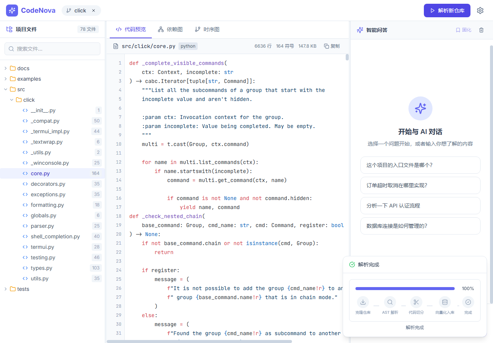
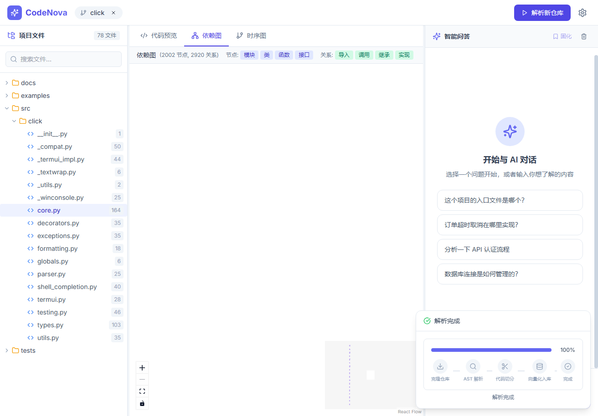
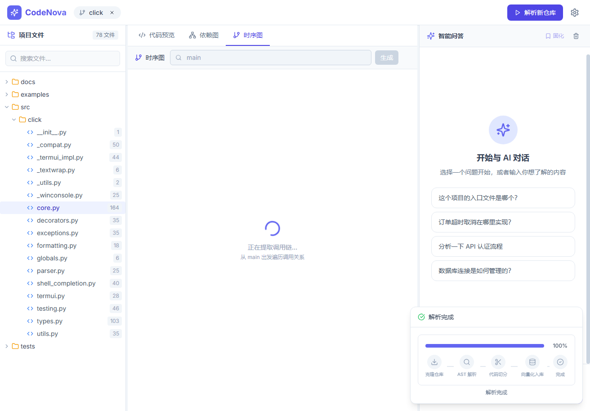
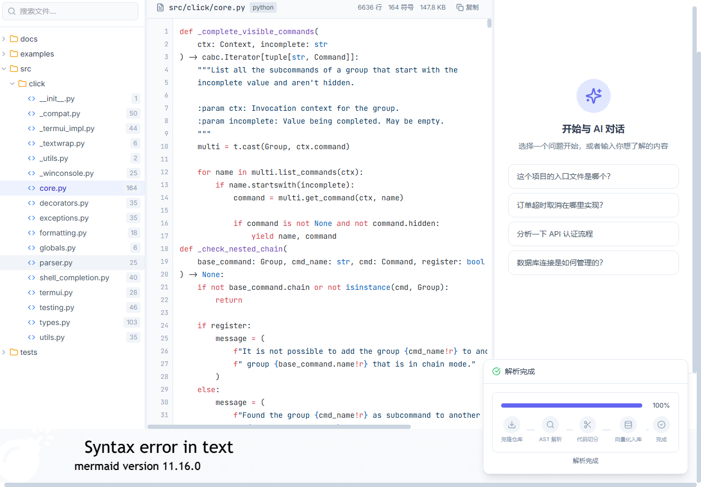

# CodeNova


[](https://codecov.io/gh/zhangwudef/codenova)

[English](README.en.md) | [简体中文](../README.md)

> Let every line of code speak for itself — a code understanding and documentation automation platform built on AST + dual-index RAG.

Feed it a code repository and get back a queryable, navigable, visualizable technical knowledge base. Built for developers taking over legacy projects, open-source maintainers, and new team members, CodeNova lowers the cost of understanding code and maintaining documentation.

---

## ✨ Demo Screenshots

> Screenshots are taken from the local demo (the parsed repository is [pallets/click](https://github.com/pallets/click)). The full feature set can be reproduced in one command via `docker-compose.demo.yml`.

### Main Interface (Three-Pane IDE-Style Layout)


### Dependency Graph (ReactFlow)


### Call Sequence Diagram (Mermaid)


### Smart Q&A (with Source Location)


### 🎬 Online Demo

> 🚧 The online demo is being deployed. For one-click self-hosting, see [docs/DEPLOYMENT.md](DEPLOYMENT.md) (supports Render / Fly.io / Railway, zero-cost launch in 5 minutes).
>
> You can also run the local demo: `docker compose -f docker-compose.demo.yml up -d`, then visit http://localhost:5173

---

## 🎯 Problem Solved

1. **Documentation drifts from code** — code iterates fast, docs update slowly, and eventually become stale.
2. **High comprehension cost** — large codebases have a steep reading curve and lack interactive exploration tools.
3. **Knowledge is not reusable** — team experience stays in individuals' heads and never becomes a searchable asset.

## 🆚 Comparison with Similar Products

| Dimension | Bloop / Greptile / Sourcegraph Cody | Mintlify / Swimm | **CodeNova** |
| --- | --- | --- | --- |
| Form factor | Closed-source SaaS | Closed-source SaaS | **Open source, self-hostable** |
| Data privacy | Code goes to the cloud | Code goes to the cloud | **Fully local processing** |
| Chunking strategy | Not public | Not public | **AST-level semantic chunking (open and auditable)** |
| Call-graph index | Most lack it | None | **Dual index: semantic + call graph** |
| Customization | Limited | Limited | **Fully modifiable** |

CodeNova's core value proposition: **open source, locally deployed, an AST-based auditable retrieval pipeline.** For a quantitative comparison of technical metrics, see [docs/benchmark.md](benchmark.md).

---

## 🧩 Features

| Module | Status | Description |
| --- | --- | --- |
| Repository parsing | ✅ | Supports Git URLs; automatically parses directory structure, dependencies, and call chains |
| AST semantic chunking | ✅ | Tree-sitter-based chunking at function/class granularity, avoiding the structural damage caused by character-based chunking |
| Code Q&A assistant | ✅ | Ask questions in natural language; the AI locates code and explains it, with source references |
| Dual-index retrieval | ✅ | Semantic vector index + call-graph index; the graph is traversed at query time to expand context |
| Architecture visualization | ✅ | Module dependency graph (ReactFlow) + call sequence diagram (Mermaid) |
| Smart doc generation | ✅ | Generates README / API / module docs by combining RAG retrieval |
| Incremental indexing | ✅ | Based on Git diff, only changed files are re-indexed |
| Q&A as documentation | ✅ | High-quality Q&A can be persisted to Markdown with one click |
| Multi-language support | ✅ | Python / JavaScript / TypeScript / Java / Go / Rust |
| Diff documentation | 🚧 | Generates a "change impact statement" by comparing two commits (roadmap) |
| Multi-perspective docs | 🚧 | Different outputs for newcomers / QA / product roles (roadmap) |

---

## 🏗️ Tech Stack

| Layer | Technology |
| --- | --- |
| Frontend | React 18 + TypeScript + Vite + Tailwind CSS + Zustand + ReactFlow + Mermaid + Shiki |
| Backend | Python 3.11 + FastAPI + Uvicorn + Celery + WebSocket |
| AI / Algorithm | OpenAI GPT-4o / Qwen2.5 + bge-m3 Embedding + Qdrant + LangChain + Tree-sitter |
| Infrastructure | PostgreSQL + Redis + MinIO + Docker Compose (full edition) |

## 🔬 System Architecture

```text
GitHub / Local Repository
        │
        ▼
[ Tree-sitter parsing ] ──► AST semantic chunking (function / class granularity)
        │
        ▼
[ bge-m3 Embedding ] ──► Qdrant vector store  ──┐
        │                                       ├──► Dual index
        └──► Call graph (import/call/inherit/implement) ──┘
        │
        ▼
[ LangChain RAG ] ◄── User question ──► Semantic recall + graph expansion → answer with source location + auto docs
```

**Key technical points** (for quantitative evaluation, see [docs/benchmark.md](benchmark.md)):

- **AST-level semantic chunking**: Tree-sitter-based chunking at function/class granularity, avoiding the structural damage caused by character-based chunking. Provides an AST → semantic → fixed-length three-tier fallback strategy.
  > Measured in S1 (CodeNova backend, 37 files / 15 questions): AST chunking achieves MRR **0.549**, **+18.6%** higher than fixed-length chunking's 0.463 — when it hits, the correct file is ranked higher. See [docs/benchmark.md §11](benchmark.md#11-s1-真实运行结果) for details.
- **Dual-index strategy**: Builds both a "code semantic index" and a "call-graph index" simultaneously; at query time, it can both semantically recall and expand context along the call graph with 1-hop traversal.
- **Incremental doc updates**: Listens to Git diff and regenerates embeddings and indexes only for changed files, avoiding full recomputation.

---

## 🚀 Quick Start

Two launch modes are provided: the **Demo edition** (3 services, lowest barrier to entry) and the **Full edition** (7 services, all features).

### Option 1: Demo Edition (recommended for first-time users)

Only requires Docker, with 3 services (backend + Qdrant + frontend) and minimal resource usage.

```bash
git clone https://github.com/zhangwudef/codenova.git
cd codenova
cp .env.example .env
# Edit .env and fill in at least OPENAI_API_KEY (for the Q&A LLM)
docker compose -f docker-compose.demo.yml up -d
```

Visit http://localhost:5173. Demo edition notes:
- ✅ Repository parsing, dependency graph, sequence diagram, RAG index, and smart Q&A are all available
- ⚠️ Async parsing (Celery) and Q&A persistence (MinIO) are not enabled; switch to the full edition to get them

### Option 2: Full Edition (all features)

```bash
git clone https://github.com/zhangwudef/codenova.git
cd codenova
cp .env.example .env
# Edit .env and fill in OPENAI_API_KEY / POSTGRES_PASSWORD / MINIO_ROOT_PASSWORD, etc.
docker compose up -d
```

> The first launch will automatically build images, download the bge-m3 embedding model, and initialize the database, which takes about 3-5 minutes.

### Access URLs

| Service | URL | Description |
| --- | --- | --- |
| Frontend Web | http://localhost:5173 | Main application interface |
| Backend API | http://localhost:8000 | FastAPI service |
| API Docs | http://localhost:8000/docs | Swagger UI |
| Qdrant Console | http://localhost:6333/dashboard | Vector store (available in both full and demo editions) |
| MinIO Console | http://localhost:9001 | Object storage (full edition only) |

---

## 📖 Usage Examples

### 1. Parse a Repository
In the frontend, click "Parse Repository", enter a GitHub URL (e.g. `https://github.com/pallets/flask.git`), and watch the parsing progress in real time.

Or call the API:
```bash
curl -X POST http://localhost:8000/api/v1/repos/parse \
  -H "Content-Type: application/json" \
  -d '{"repo_url": "https://github.com/pallets/flask.git", "max_files": 200}'
```

### 2. Build the Index and Ask a Question
```bash
# Build the vector index
curl -X POST http://localhost:8000/api/v1/rag/index \
  -H "Content-Type: application/json" \
  -d '{"repo_url": "https://github.com/pallets/flask.git"}'

# Ask a question
curl -X POST http://localhost:8000/api/v1/rag/ask \
  -H "Content-Type: application/json" \
  -d '{"question": "Where is the request context created?", "repo_url": "https://github.com/pallets/flask.git"}'
```

### 3. Get the Dependency Graph / Sequence Diagram
```bash
# Dependency graph
curl "http://localhost:8000/api/v1/repos/graph?type=dependency&repo_url=https://github.com/pallets/flask.git"

# Call sequence diagram (specify the entry function)
curl "http://localhost:8000/api/v1/repos/sequence?repo_url=https://github.com/pallets/flask.git&entry=run"
```

For more examples, see [DEMO_REPOS.md](../DEMO_REPOS.md).

---

## 📁 Project Structure

```text
codenova/
├── backend/                 FastAPI backend
│   ├── app/
│   │   ├── api/             Route layer (repos / rag / graph / ws / health)
│   │   ├── core/            Config, Celery
│   │   ├── models/          Data models
│   │   └── services/        Business services (parsing / RAG / call graph)
│   ├── scripts/             Initialization scripts
│   ├── tests/               Unit and integration tests
│   ├── Dockerfile
│   ├── pyproject.toml       ruff / mypy config
│   └── requirements.txt
├── frontend/                React + TypeScript frontend
│   ├── src/
│   │   ├── components/      UI components
│   │   └── stores/          Zustand state
│   ├── Dockerfile
│   └── package.json
├── docs/                    Documentation (benchmark / screenshots)
├── docker-compose.yml       Full edition multi-service orchestration
├── docker-compose.demo.yml  Lightweight demo edition (3 services)
├── .env.example             Environment variable template
├── .pre-commit-config.yaml  Code style hooks
├── DEMO_REPOS.md            Demo repository list
├── 项目方案.md              Design document
├── LICENSE
└── README.md
```

---

## ⚙️ Environment Variables

Key configuration items are in [.env.example](../.env.example), including:

| Variable | Description | Required for Demo? |
| --- | --- | --- |
| `OPENAI_API_KEY` | OpenAI / compatible service key (Q&A LLM) | ✅ Required |
| `OPENAI_BASE_URL` | LLM service URL (can point to Qwen, etc.) | Optional |
| `QDRANT_API_KEY` | Qdrant API key | Optional |
| `POSTGRES_PASSWORD` | PostgreSQL password | Full edition only |
| `MINIO_ROOT_PASSWORD` | MinIO console password | Full edition only |
| `GITHUB_TOKEN` | GitHub API token (raises clone rate limits) | Optional |

> `.env` is excluded by `.gitignore` and will not be committed. Do not commit real credentials.

---

## 🧪 Tests & Benchmark

### Unit Tests
```bash
cd backend
python -m pytest tests/ -v
```
Integration tests that depend on external services (Qdrant / Embedding) are skipped by default; remove the skip marker after starting the services to run them.

### Performance Benchmark
Retrieval quality and performance benchmarks (AST chunking vs naive chunking, dual index vs pure semantic, multi-language parsing time, etc.) are in [docs/benchmark.md](benchmark.md).

---

## 🛣️ Roadmap

- [x] AST semantic chunking + three-tier fallback
- [x] Dual-index (semantic + call graph) retrieval
- [x] Incremental indexing (Git diff)
- [x] Q&A-as-document persistence
- [x] Dependency graph / sequence diagram visualization
- [ ] Diff documentation (change impact statement)
- [ ] Multi-perspective doc output (newcomers / QA / product)
- [x] CI pipeline (GitHub Actions: pytest + frontend build, ruff non-blocking)
- [ ] Frontend unit tests
- [ ] Online demo deployment
- [x] English README

---

## 🤝 Contributing

Contributions via Pull Request are welcome. Please make sure to:

1. Install the pre-commit hooks: `pip install pre-commit && pre-commit install`
2. Pass `pre-commit run --all-files` (ruff, ruff-format, general rules)
3. Include tests for new features
4. Follow [Conventional Commits](https://www.conventionalcommits.org/) for commit messages (e.g. `feat:`, `fix:`, `docs:`)

Backend code style is enforced by the ruff config in [pyproject.toml](../backend/pyproject.toml) (line width 100, target Python 3.11).

For the full contribution guide, please see [CONTRIBUTING.md](../CONTRIBUTING.md).

---

## 📄 License

This project is licensed under the [MIT License](LICENSE), Copyright (c) 2026 zhangwudef.

---

## ⭐ Star History

[](https://star-history.com/#zhangwudef/codenova&Date)

---

## 🏢 Used By

> If your project uses CodeNova, feel free to open a PR to be listed here.

_None yet — be the first!_
